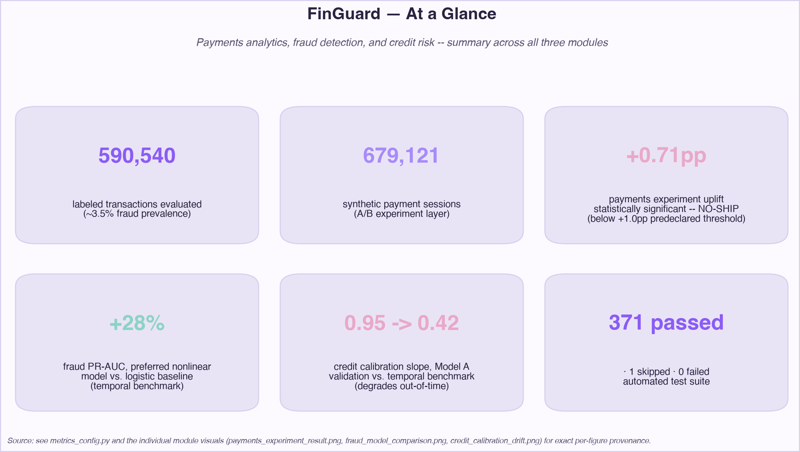
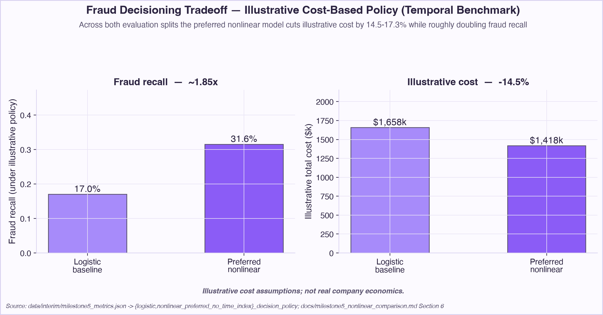
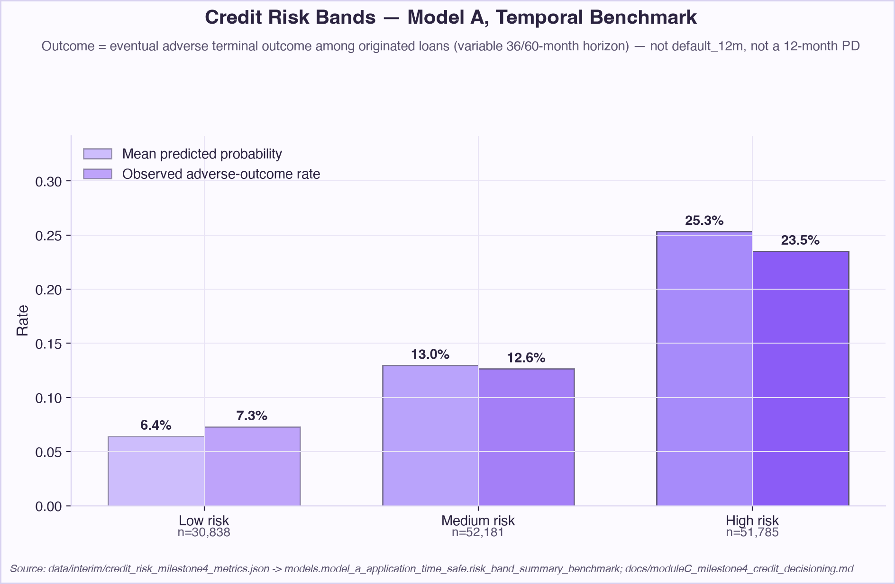

# FinGuard

### Payments, Fraud & Credit Risk Decisioning Platform

FinGuard is an end-to-end FinTech data science project covering the three
problems a consumer lending/payments business has to solve: understanding
and improving the payments funnel, detecting fraud under adversarial
drift, and deciding which loans to originate and how much loss to expect
from them. Every model is built the way a real risk/analytics team would
build it — chronologically validated, calibration-checked, and turned
into a business decision with an explicit cost, not just a leaderboard
metric — and every limitation is reported next to the result it affects,
not hidden in a disclaimer.

All modeling uses **public transaction and lending data** (IEEE-CIS Fraud
Detection, LendingClub accepted loans). A clearly labeled **synthetic
supporting layer** (payment sessions, retries, and A/B-test
assignment/outcomes) is layered on top of the real IEEE-CIS transactions
only where the public dataset has no native concept of a checkout session
or experiment — never presented as real.

<p align="center">
  
</p>

## Key results

All numbers below are generated, reproducible figures — traced to the
scripts/configs cited in [Deep-dive documentation](#deep-dive-documentation),
not hand-picked for effect.

| Area | Result |
|---|---|
| Fraud dataset scale | IEEE-CIS: 590,540 labeled transactions, ~3.5% fraud prevalence — real data, not synthetic |
| Fraud model comparison | Nonlinear model (`HistGradientBoostingClassifier`) lifts temporal-benchmark PR-AUC from 0.120 (logistic baseline) to 0.154 (+28% relative) and ROC-AUC from 0.732 to 0.780 |
| Fraud decisioning | Under identical illustrative cost assumptions, the preferred nonlinear configuration's decision policy roughly doubles fraud recall at a 14.5-17.3% lower illustrative total cost than the logistic baseline's own policy |
| Payments experiment | A synthetic A/B test on real transaction data found a statistically significant +0.71 pp completion-rate uplift (0.8692→0.8763, p≈2.2e-18) that still returned a **NO-SHIP** decision — it missed the predeclared +1.0 pp practical-significance threshold |
| Credit risk discrimination | Two logistic PD baselines on real LendingClub data, evaluated out-of-time: ROC-AUC 0.657-0.676 — modest, honestly reported, not a strong classifier |
| Credit risk calibration | Out-of-time calibration slope drops from 0.95→0.42 (Model A) and 0.85→0.50 (Model B), validation→benchmark — a real finding, surfaced rather than smoothed over |
| Test coverage | Full repository suite: **371 passed, 1 skipped, 0 failed** |

No model in any module has been selected for production deployment —
every result above is a comparison, calibration check, or illustrative
decisioning exercise, not a shipped system.

## Modules

| Module | Focus | Key techniques | Status |
|---|---|---|---|
| **A — Payments / Product Analytics** | SQL KPI layer, funnel analysis, retry/recovery, A/B experimentation, guardrails | DuckDB SQL, two-proportion z-test, power/MDE, ship/no-ship decision rule | Complete |
| **B — Fraud / Risk Modeling** | Point-in-time features, chronological validation, logistic baseline, gradient boosting, calibration, operational decisioning | scikit-learn, out-of-sample sigmoid/isotonic calibration, illustrative cost-based decisioning | Complete |
| **C — Credit Risk / Expected Loss** | Target/censoring design, leakage governance, lender-signal ablation, calibration & stability diagnostics, illustrative expected loss | LendingClub chronological split, logistic PD models, LGD × EAD expected loss | Complete |

## Architecture

Every module follows the same pipeline shape:

```
Raw data → validation/leakage review → feature/KPI layer →
modeling/experimentation → calibration/decisioning → governance & limitations
```

Each module ingests real (or real+clearly-labeled-synthetic) data, builds
a transparent point-in-time-safe feature or KPI layer, fits a model or
runs an experiment, calibrates probabilities or evaluates statistical
significance strictly out-of-sample, and only then turns that into a
business decision (approve/review/decline, a cost-based threshold, a
ship/no-ship call) — with governance diagnostics (drift, selection bias,
calibration decay) checked explicitly, not skipped.

<p align="center">
  
</p>
<p align="center"><em>The same data → validation → feature/KPI → modeling/experimentation → decisioning pipeline, applied independently in each module.</em></p>

## Module A — Payments / Product Analytics

**The problem:** does a proposed change to the checkout flow improve
completion enough to be worth shipping? A synthetic session, retry, and
A/B-assignment layer — built on top of real IEEE-CIS transaction rows — is
used to run that experiment the way a payments analytics team would: with
a predeclared practical-significance threshold decided *before* looking at
results, not after.

**What the analysis showed:**

<p align="center">
  
</p>
<p align="center"><em>Statistically significant, but below the predeclared practical-significance threshold.</em></p>

**The decision:** the treatment's completion-rate uplift was **+0.71
percentage points**, **statistically significant** (p≈2.2e-18) — and still
**NO-SHIP**, because the predeclared practical-significance threshold was
**+1.0 pp** and the observed effect didn't clear it. This is a synthetic,
simulated experiment layered on real transaction data, not a live
production test; the lesson it illustrates — that statistical significance
alone doesn't justify shipping — is the point of the exercise.

## Module B — Fraud / Risk Modeling

**The problem:** separate fraudulent from legitimate transactions under
severe class imbalance (~3.5% fraud prevalence), evaluated strictly
out-of-time on a chronological benchmark split so performance isn't
overstated by a random train/test split.

**What the analysis showed:**

<p align="center">
  
</p>
<p align="center"><em>The nonlinear model improves PR-AUC — the more important metric here given low fraud prevalence — and ROC-AUC over the logistic baseline.</em></p>

<p align="center">
  
</p>
<p align="center"><em>Under illustrative cost assumptions (not real company economics), the nonlinear model's decision policy roughly doubles fraud recall at lower illustrative total cost.</em></p>

**The decision:** the preferred nonlinear model (`HistGradientBoostingClassifier`)
is favored on both ranking quality (PR-AUC 0.120→0.154, +28% relative) and
illustrative operational economics. Cost figures throughout are
illustrative, config-driven assumptions — not a claim of real company
savings.

## Module C — Credit Risk / Expected Loss

**The problem:** among originated LendingClub loans, how risky is a loan
at approval time, and — just as importantly — can the model's predicted
probabilities themselves be trusted as *probabilities*, not just a
ranking, when applied out-of-time?

**What the analysis showed:**

<p align="center">
  
</p>
<p align="center"><em>Mean predicted probability tracks the observed adverse-outcome rate reasonably well across risk bands on the temporal benchmark.</em></p>

<p align="center">
  
</p>
<p align="center"><em>Probability calibration degrades out-of-time despite stable score-distribution diagnostics.</em></p>

**The decision / lesson:** calibration slope falls from 0.95→0.42 (Model A)
and 0.85→0.50 (Model B), validation→benchmark, even though each model's
score-distribution PSI stayed low and stable over the same period.
**Stable score distributions do not guarantee stable probability
calibration** — the central governance lesson of this module, and the
reason calibration, not just discrimination, is checked explicitly before
any decisioning step. The dataset contains **originated loans only**
(a selection-bias limitation), the primary target is a variable-horizon
**terminal adverse outcome — not a 12-month PD**, and the expected-loss
figures are **illustrative** (config-driven LGD/EAD/cost assumptions, not
real LendingClub underwriting or pricing). See
[Limitations](#limitations) for the full caveat list.

## Technical stack

- **Language:** Python 3.12 (pinned via `.python-version` / pyenv)
- **SQL engine:** DuckDB — queries raw CSVs in place rather than loading full wide tables into pandas
- **Data:** pandas, NumPy
- **Modeling:** scikit-learn (logistic regression, `HistGradientBoostingClassifier`, calibration), statsmodels (two-proportion z-test, power analysis, Cox calibration-slope/intercept diagnostic)
- **Testing:** pytest
- **Version control:** Git

## Data

**IEEE-CIS Fraud Detection** (Module B, and the real-data backbone of
Module A) — a public
[Kaggle competition dataset](https://www.kaggle.com/competitions/ieee-fraud-detection)
hosted by the IEEE Computational Intelligence Society, with data provided
by Vesta Corporation. 590,540 labeled transactions (`train_transaction`),
~3.5% fraud prevalence (`isFraud`). **Public competition data — not from
any employer.** Raw CSVs are not committed to Git; download manually from
Kaggle into `data/raw/`.

**LendingClub accepted loans, 2007-2018Q4** (Module C) — a specific,
checksum-verified public mirror of LendingClub's accepted-loans file
(`configs/credit_risk_raw_source_metadata.json` records the exact URL and
SHA256). 2,260,668 loan rows, 151 columns, originations 2007-06 through
2018-12. The mirror carries no explicit license/usage-terms statement of
its own (only an origin citation); a separate Kaggle listing of
apparently the same data is tagged "CC0: Public Domain," but that tag
belongs to Kaggle's page and is not treated as inherited here. The
dataset contains only **originated (accepted)** loans — see
[Limitations](#limitations). Raw CSV is gitignored, not committed.

**Synthetic payments/session/experiment layer** (Module A) — IEEE-CIS has
no native concept of a checkout session, decline/retry, or A/B test, so
Module A adds a synthetic session/attempt and experiment layer **on top
of the same real IEEE-CIS transaction rows**, with every synthetic field
explicitly labeled as such in
[docs/payments_data_model.md](docs/payments_data_model.md). No real
checkout funnel, no real A/B test, and no real company's experiment is
described anywhere in this module.

## Project design principles

- **Chronological, not random, evaluation** — Module B's train /
  validation / temporal-benchmark split and Module C's train / validation
  / benchmark split are both time-ordered; nothing is shuffled across time.
- **Point-in-time feature safety** — an automated leakage-keyword safety
  net plus an explicit feature-eligibility policy in both Module B and
  Module C, so a feature only known after the outcome can't quietly enter
  a model.
- **Calibration and probability quality as a first-class concern** —
  sigmoid/isotonic comparison fit and evaluated strictly out-of-sample,
  plus a Cox calibration-slope/intercept diagnostic in Module C that
  caught out-of-time calibration decay Brier score and PSI alone missed.
- **Business decisioning over metric-only optimization** — every model is
  followed by an explicit cost-based decision layer (approve/review/
  decline, LGD×EAD expected loss) rather than stopping at ROC-AUC.
- **Explicit synthetic-data labeling** — Module A's entire session/
  experiment layer is marked synthetic everywhere it appears; it is never
  presented as a real product or a real experiment.
- **Reproducibility** — every headline number traces to a script and a
  config file; assumptions (cost, LGD, treatment-effect size) live in
  versioned JSON, not hardcoded in code.
- **Governance and limitations stated next to the result** — selection
  bias, illustrative-only cost/LGD assumptions, and calibration decay are
  reported alongside the numbers they affect, not relegated to a
  disclaimer at the bottom.

## Repository structure

```
configs/          JSON configs (paths, cost/LGD assumptions, experiment
                  assumptions, target/split/feature definitions) — no
                  hardcoded paths or assumptions in code
data/raw/         Raw CSVs (gitignored, not committed)
data/interim/     Intermediate run artifacts (gitignored)
data/processed/   Built feature tables (gitignored)
docs/             Per-milestone write-ups, dictionaries, and the
                  append-only decision log
src/data/         IEEE-CIS loading, inspection, join validation, leakage checks
src/features/     Point-in-time-safe feature engineering (Module B)
src/models/       Chronological split, preprocessing, logistic + nonlinear
                  models, calibration, cost-based decisioning (Module B)
src/payments/     Synthetic session/funnel + experimentation layer,
                  DuckDB-SQL-first, no fitted models (Module A)
src/credit_risk/  Schema, target/censoring, chronological split, PD
                  models, calibration, expected loss, decisioning
                  (Module C)
tests/            pytest suite (mirrors src/ layout; real-data-gated
                  tests auto-skip with a clear reason when raw CSVs
                  aren't present)
```

## Reproducibility

```bash
pyenv local 3.12.7          # already configured via .python-version
python3 -m venv .venv
source .venv/bin/activate
pip install -r requirements.txt
```

Place raw data (not bundled with this repo):

- `data/raw/train_transaction.csv`, `train_identity.csv`,
  `test_transaction.csv`, `test_identity.csv` — downloaded manually from
  the Kaggle IEEE-CIS competition.
- `data/raw/LendingClub_2007_to_2018Q4.csv` — see
  `configs/credit_risk_raw_source_metadata.json` for the exact mirror URL
  and checksum.

Run the full test suite (tests that need raw data auto-skip if it's
absent):

```bash
pytest -q
```

Representative module commands (each writes a reproducibility JSON to
`data/interim/` and a stdout report):

```bash
python -m src.data.run_all                        # Module B data inspection
python -m src.features.build_baseline_dataset      # Module B feature build
python -m src.models.train_nonlinear               # Module B best model
python -m src.payments.build_experiment_report      # Module A experiment
python -m src.credit_risk.run_milestone4_decisioning # Module C decisioning
```

Full per-module reproduction steps, exact expected outputs, and every
intermediate command live in the module docs linked below.

## Deep-dive documentation

- **Payments analytics & experimentation:** [docs/payments_data_model.md](docs/payments_data_model.md), [docs/moduleA_milestone2_experimentation.md](docs/moduleA_milestone2_experimentation.md)
- **Nonlinear fraud model comparison:** [docs/milestone5_nonlinear_comparison.md](docs/milestone5_nonlinear_comparison.md)
- **Fraud calibration & decisioning:** [docs/milestone4_calibration_decisioning.md](docs/milestone4_calibration_decisioning.md)
- **Credit risk baseline (Model A / Model B):** [docs/moduleC_milestone3_credit_baseline.md](docs/moduleC_milestone3_credit_baseline.md)
- **Credit risk expected loss & decisioning:** [docs/credit_risk_expected_loss_framework.md](docs/credit_risk_expected_loss_framework.md), [docs/moduleC_milestone4_credit_decisioning.md](docs/moduleC_milestone4_credit_decisioning.md)
- **Full decision history (every non-trivial decision, append-only):** [docs/decision_log.md](docs/decision_log.md)

## Limitations

- **Module A's entire payment-session/experiment layer is synthetic**,
  built on top of real IEEE-CIS transactions — no real checkout funnel or
  real A/B test exists anywhere in this module. See
  [docs/payments_data_model.md](docs/payments_data_model.md) and
  [docs/moduleA_milestone2_experimentation.md](docs/moduleA_milestone2_experimentation.md).
- **Module C's dataset contains only originated (accepted) loans** — a
  selection-bias/target-population limitation. Any PD model here
  estimates default risk among already-approved loans, not across the
  full applicant population, and must not be presented as a complete
  approve/decline underwriting model. See
  [docs/credit_risk_dataset_comparison.md](docs/credit_risk_dataset_comparison.md)
  and
  [docs/moduleC_milestone2_real_data_validation.md](docs/moduleC_milestone2_real_data_validation.md)
  §H.
- **Module C's primary target, `terminal_adverse_outcome`, is NOT a
  12-month probability of default** — it's a variable-horizon (36- or
  60-month) estimate of eventual adverse resolution among originated
  loans. See
  [docs/moduleC_milestone2_real_data_validation.md](docs/moduleC_milestone2_real_data_validation.md)
  §D and
  [docs/moduleC_milestone4_credit_decisioning.md](docs/moduleC_milestone4_credit_decisioning.md).
- **Module C's expected-loss and decisioning figures are illustrative**
  (LGD=0.8, EAD≈`loan_amnt`, flat review/opportunity costs) — author-
  chosen, config-driven assumptions, not real LendingClub underwriting,
  pricing, or recovery figures. See
  [docs/credit_risk_expected_loss_framework.md](docs/credit_risk_expected_loss_framework.md).
- **Module B's final chronological split segment ("temporal benchmark")
  is not a pristine holdout** — it has been inspected iteratively across
  Milestones 3-5 and should not be treated as a never-touched final test
  set. See
  [docs/milestone4_calibration_decisioning.md](docs/milestone4_calibration_decisioning.md).

## License / data provenance

This project's own code and documentation are licensed under the
[MIT License](LICENSE). That license covers this repository's original
source code and written content only — it does **not** extend to, and
does not grant any rights over, the third-party datasets described
below. Raw external datasets are **not redistributed** here —
`data/raw/` is gitignored, and users must obtain data directly from the
original sources.

This project uses only public datasets — the IEEE-CIS Fraud Detection
dataset under Kaggle's competition terms, and a public LendingClub
accepted-loans mirror (license caveat above) — plus a synthetic layer
that is clearly labeled as such everywhere it appears. Each external
dataset remains subject to its own source/access terms, as described in
the [Data](#data) section above. No proprietary, employer, or
confidential data is used anywhere in this repository.
