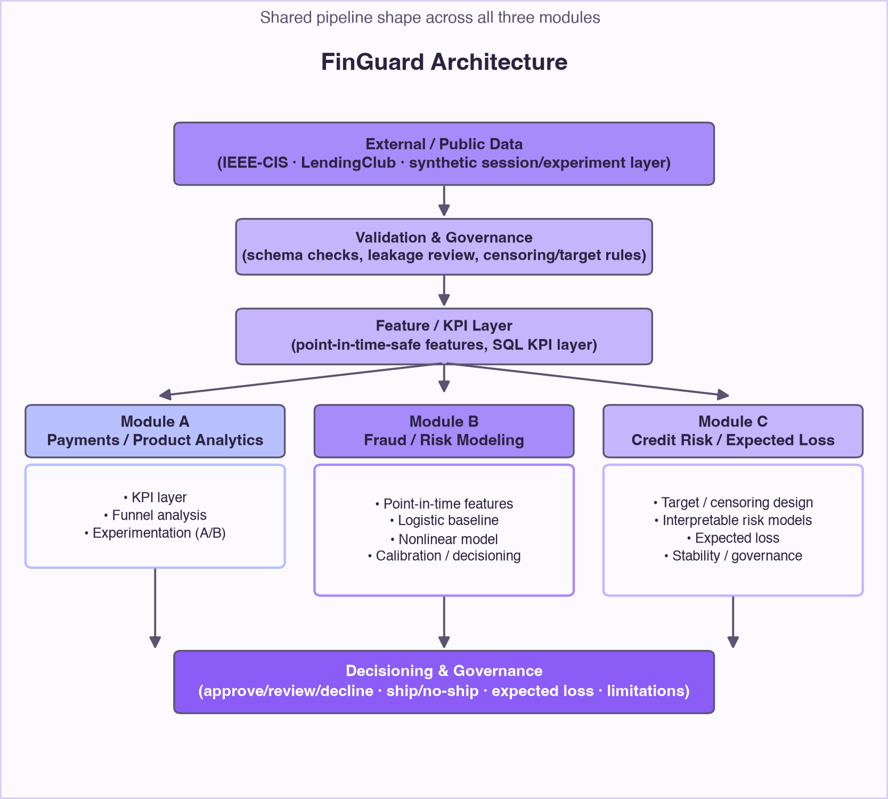
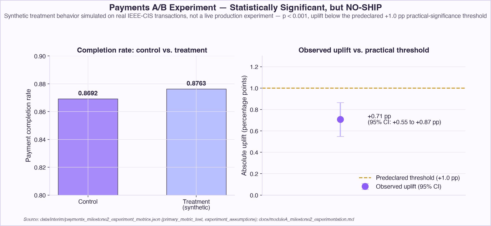
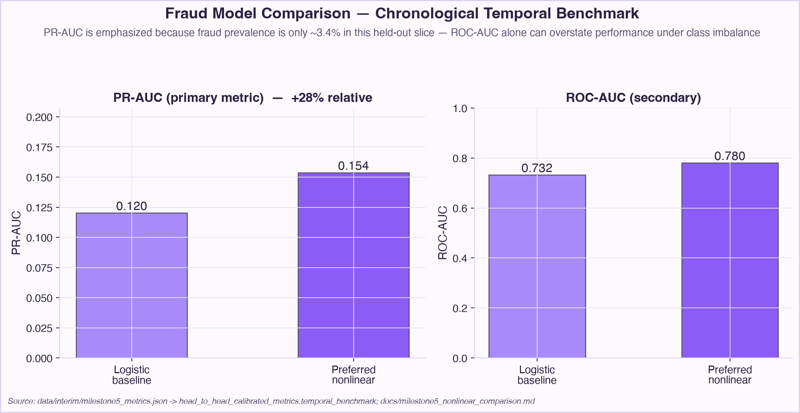
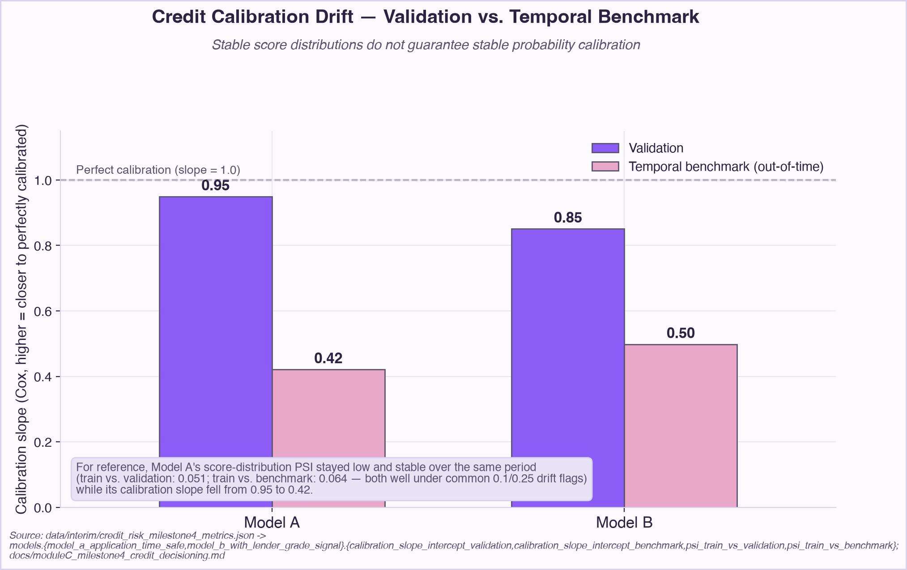

# FinGuard — Payments, Fraud & Credit Risk Decisioning

FinGuard is an end-to-end FinTech data science case study spanning three
decisions a consumer lending/payments business has to make continuously:
how to improve the payments funnel, how to detect fraud without letting
losses or false declines spiral, and how to decide which loans to
originate and how much loss to expect from them. All modeling runs on
**public, real-world data** — the IEEE-CIS Fraud Detection transaction
dataset and LendingClub's accepted-loans history. A clearly labeled
**synthetic supporting layer** (checkout sessions, retries, and A/B-test
assignment and outcomes) is added on top of the real IEEE-CIS transaction
rows only because that public dataset has no native concept of a checkout
session or an experiment — it is never presented as a real company's
product or a live experiment.

## The business problem

A payments or lending system cannot optimize for a single metric. Every
decision it makes trades off against another: a funnel change that lifts
conversion can also increase downstream risk; a fraud model tuned purely
for accuracy will either miss costly fraud or decline so many legitimate
customers that review queues and customer trust absorb the damage; a
credit model that ranks risk well can still be miscalibrated, which
breaks any pricing or reserving decision built on top of it. A production
system has to balance customer conversion, fraud losses, false positives,
operational review capacity, credit risk, the reliability of its own
probability estimates, and the governance needed to catch when any of
those degrade. FinGuard is built around that balance rather than around a
single leaderboard metric: every model here is followed by an explicit,
cost-aware business decision, and every result is reported next to the
limitation that qualifies it.

## Project architecture

The project is organized into three modules that share one pipeline
shape — data validation, a point-in-time-safe feature or KPI layer,
modeling or experimentation, and finally calibration/decisioning with
explicit governance checks.

**Module A — Payments / Product Analytics.** A SQL-first KPI layer over
checkout funnel and retry behavior, and a predeclared A/B experiment with
a power/MDE analysis and an explicit ship/no-ship decision rule.

**Module B — Fraud / Risk Modeling.** Point-in-time-safe features,
chronological (not random) validation, a logistic baseline and a
gradient-boosted nonlinear model, out-of-sample probability calibration,
and an illustrative cost-based decisioning layer.

**Module C — Credit Risk / Expected Loss.** A censoring-aware target and
split design, interpretable logistic credit-risk models, an ablation testing
whether lender-assigned signals (grade, sub-grade, interest rate) add
real discrimination, calibration and score-stability diagnostics, and an
illustrative LGD × EAD expected-loss calculation.

## Key technical decisions

A few decisions here matter more than any single metric, because they
determine whether a result holds up out of sample:

- **Chronological, not random, evaluation.** Fraud and credit splits are
  time-ordered (train → validation → temporal benchmark), so performance
  is never inflated by information bleeding backward across time.
- **Point-in-time feature construction.** An automated leakage-keyword
  check plus an explicit feature-eligibility policy keep
  only-known-after-the-outcome fields out of the model.
- **PR-AUC, not just ROC-AUC, for imbalanced fraud.** At ~3.5% fraud
  prevalence, ROC-AUC alone can look deceptively strong, so PR-AUC is
  treated as the primary ranking metric.
- **Calibration evaluated as its own concern**, via a Cox
  calibration-slope diagnostic checked separately from ranking quality
  and from score-distribution stability (PSI) — none of the three
  guarantees the other two.
- **Practical significance, not just statistical significance.** The
  payments ship/no-ship rule is a practical-significance threshold
  predeclared before the result is known, not a p-value cutoff chosen
  after.
- **Censoring-aware credit target design**, using an explicit,
  variable-length observation horizon rather than a fixed, arbitrary one.
- **Selection bias named explicitly.** LendingClub covers originated
  (already-accepted) loans only, treated as a first-class caveat, not a
  footnote.
- **Prediction, expected loss, and business decision kept as separate
  layers**, so a changed assumption (e.g. cost) isn't mistaken for a
  change in model quality.

## Key results

- **Fraud dataset scale:** 590,540 labeled transactions, ~3.5% fraud
  prevalence — real data, not synthetic.
- **Fraud model comparison:** on the chronological temporal benchmark,
  the preferred nonlinear model (`HistGradientBoostingClassifier`) lifts
  PR-AUC from 0.120 (logistic baseline) to 0.154 (+28% relative) and
  ROC-AUC from 0.732 to 0.780.
- **Fraud decisioning:** under identical illustrative cost assumptions,
  the nonlinear model's decision policy roughly doubles fraud recall
  while reducing illustrative total cost by about 14.5–17.3%, depending
  on the split evaluated.
- **Payments experiment:** a synthetic A/B test on real transaction data
  produced a statistically significant +0.71 percentage-point
  completion-rate uplift (p ≈ 2.2e-18) — and still returned a **NO-SHIP**
  decision, because it fell short of the predeclared +1.0 pp
  practical-significance threshold.
- **Credit risk discrimination:** two logistic credit-risk models evaluated
  out-of-time reach ROC-AUC 0.657–0.676 — modest, honestly reported, and
  not oversold as a strong classifier. Adding lender-assigned signals
  (grade/sub-grade/interest rate) lifts discrimination only modestly
  (+0.003 ROC-AUC on validation, +0.015 on the temporal benchmark).
- **Credit calibration drift:** out-of-time calibration slope falls from
  0.95→0.42 (Model A) and 0.85→0.50 (Model B), validation to temporal
  benchmark, even though each model's score-distribution PSI stayed low
  and stable over the same period.

## Business decisions and lessons

**Payments:** a statistically significant result is not automatically a
shippable one. The uplift was real and highly significant, but it didn't
clear the bar set *before* the test ran, so the decision is NO-SHIP — a
concrete illustration that statistical and practical significance are
different questions.

**Fraud:** the nonlinear model is the better choice on both ranking
quality and illustrative operational economics, but the deployable
decision threshold still depends on assumptions made explicit here —
assumed review capacity and the assumed cost of a missed fraud versus a
false decline. Change those inputs and the optimal threshold moves; the
model's PR-AUC doesn't.

**Credit:** modest discrimination (ROC-AUC in the high 0.6s) paired with
material out-of-time calibration decay is the more important finding
than either number alone — a model that ranks reasonably well can still
produce probabilities no longer trustworthy for pricing or reserving
months later, which is why calibration is monitored as an ongoing
governance signal, not a one-time check.

Across all three modules, prediction, expected loss, and the business
decision built on top of them are kept as distinct layers. A model's
score is an input to a decision, not the decision itself.

## Limitations

- The payments module's entire session/experiment layer is **synthetic**
  — layered on real IEEE-CIS transactions, but no real checkout funnel or
  real A/B test exists in this project.
- Fraud decisioning **cost assumptions are illustrative**, not a real
  company's loss, review-capacity, or operational figures.
- The fraud module's final chronological split ("temporal benchmark") was
  **inspected iteratively over the course of the project**, so it should
  not be treated as a pristine, never-touched holdout.
- LendingClub data covers **originated (accepted) loans only** — any
  credit model here estimates risk among already-approved loans, not
  across a full applicant population.
- The credit target, `terminal_adverse_outcome`, is a **variable-horizon
  eventual outcome, not a 12-month probability of default**.
- Credit expected-loss figures use **illustrative LGD/EAD/cost
  assumptions** — not regulatory, CECL, or Basel-grade estimates.

## What this project demonstrates

- SQL-first analytical data modeling (DuckDB) alongside a pandas/NumPy
  feature and KPI layer.
- Statistical experimentation: power/MDE analysis, a two-proportion
  z-test, and a predeclared practical-significance decision rule.
- Point-in-time-safe feature engineering with an automated leakage check.
- Classification under severe class imbalance, with PR-AUC treated as the
  primary metric rather than ROC-AUC alone.
- Probability calibration evaluated as a distinct concern from both
  ranking quality and score-distribution stability.
- Business decisioning layered explicitly on top of model output —
  cost-based thresholds, ship/no-ship rules, and illustrative expected
  loss — rather than stopping at a model metric.
- Time-aware (chronological) validation across both the fraud and credit
  modules.
- Credit-risk target and governance design, including censoring-aware
  outcome definitions and an explicit selection-bias limitation.
- Reproducibility and testing discipline: every headline number traces to
  a versioned script and config, backed by an automated test suite.

## Recommended visuals for web version

These four — architecture, payments experiment, fraud model comparison,
and credit calibration drift — are the strongest single-chart summaries
of this project's architecture, its clearest business decision, its
strongest model-comparison result, and its most important governance
finding, respectively.
